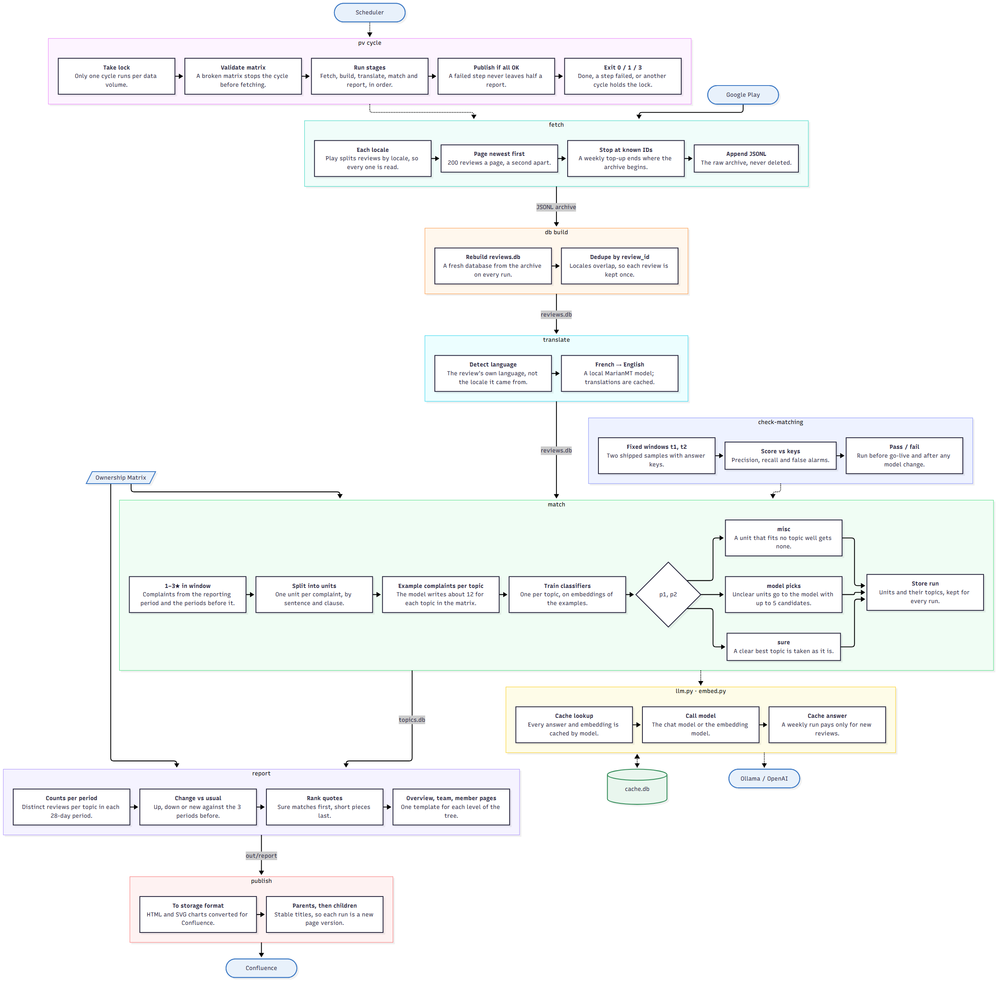
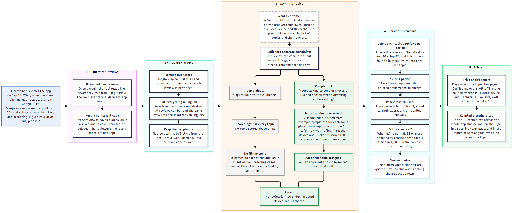

# Product View architecture

Two diagrams: the whole system, and one review's journey from Google Play to a report.

## The whole system

Each box is a component and the steps inside it, in order. Solid arrows carry data,
labelled with the store between the two; dotted arrows are calls.

Source: [diagrams/system.mmd](diagrams/system.mmd)

## One review, from Play Store to the report

Read left to right. It follows one real review, posted on Sep 17, 2026, from Google Play to the report page of the person who owns the feature it complains about. Each large box is one stage of the process. The boxes inside it say what that stage does and what happened to this review. Green marks the part of the review that was matched to a topic, and grey marks the part that wasn't. Each step, with its code, is in [the Q&A sheet](qa.md#one-review-from-play-store-to-the-report).

Source: [diagrams/journey.mmd](diagrams/journey.mmd)
